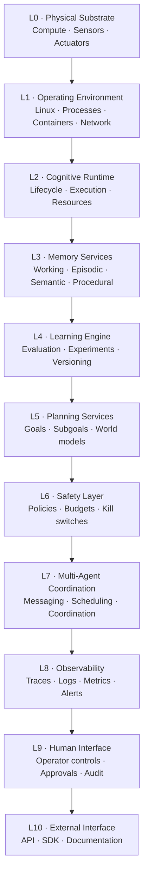

<div align="center">

# 🧁 MUFFIN.AI

### Cognitive Infrastructure for AI Agents, Robots, and Intelligent Systems

**Memory · Runtime Control · Safety · Observability**

*“We are not building the brain. We are building the infrastructure that helps intelligent systems remain useful, inspectable, and controllable over time.”*

[Repository](https://github.com/yashvardhansingh442-dev/MUFFIN) · [Issues](https://github.com/yashvardhansingh442-dev/MUFFIN/issues) · [Architecture](docs/architecture.md) · [Contributing](CONTRIBUTING.md)

</div>

---

> **Project status:** Early-stage, actively evolving research and engineering project. The repository currently contains an initial Python runtime prototype and supporting research areas—not the complete long-term platform described in the architecture. Features marked *planned* are design goals, not shipped capabilities.

## Table of Contents

- [1. What Is MUFFIN?](#1-what-is-muffin)
- [2. The Problem](#2-the-problem)
- [3. The Product Thesis](#3-the-product-thesis)
- [4. Who It Is For](#4-who-it-is-for)
- [5. Core Product: The Cognitive Runtime](#5-core-product-the-cognitive-runtime)
- [6. Architecture](#6-architecture)
- [7. Memory Model](#7-memory-model)
- [8. Safety and Control](#8-safety-and-control)
- [9. Observability and Debuggability](#9-observability-and-debuggability)
- [10. Current Implementation vs. Long-Term Vision](#10-current-implementation-vs-long-term-vision)
- [11. Near-Term MVP](#11-near-term-mvp)
- [12. Repository Structure](#12-repository-structure)
- [13. Technology Direction](#13-technology-direction)
- [14. Getting Started](#14-getting-started)
- [15. Example: A Minimal Agent](#15-example-a-minimal-agent)
- [16. Development Workflow and Quality Bar](#16-development-workflow-and-quality-bar)
- [17. Research and Engineering Pillars](#17-research-and-engineering-pillars)
- [18. Roadmap](#18-roadmap)
- [19. Design Principles](#19-design-principles)
- [20. Security, Privacy, and Responsible Use](#20-security-privacy-and-responsible-use)
- [21. Research References](#21-research-references)
- [22. Contributing](#22-contributing)
- [23. Limitations and Disclaimer](#23-limitations-and-disclaimer)
- [24. Founder](#24-founder)

---

## 1. What Is MUFFIN?

**MUFFIN.AI is an attempt to build a cognitive infrastructure layer for intelligent software agents and, eventually, embodied systems such as robots.**

Today's agent developers often have to assemble the surrounding machinery themselves: execution lifecycle management, persistent experience, action permissions, failure recovery, traces, monitoring, and human override. MUFFIN's thesis is that these capabilities should be designed as a coherent infrastructure layer rather than rebuilt independently inside every application.

The long-term analogy is:

| Existing infrastructure | Role in software systems | MUFFIN's intended analogue |
|---|---|---|
| AWS | Compute and storage | Runtime resources and durable state for agents |
| Kubernetes | Workload lifecycle and orchestration | Agent lifecycle and, later, coordination |
| Datadog | Monitoring and observability | Visibility into agent runs, actions, and failures |
| Trusted payment rails such as Stripe | Consistent interfaces and reliable transactions | Policy-enforced, auditable action execution |

These are **analogies for the product direction**, not claims that MUFFIN currently offers equivalent scale or functionality.

### The one-line vision

> **Build infrastructure so intelligence doesn't become unmanageable as it runs, learns, and acts over time.**

### What MUFFIN is—and is not

- **It is:** a runtime and infrastructure research project focused on memory, action control, traceability, and safe execution for agents.
- **It is intended to become:** a modular platform with memory services, safety policies, observability, human controls, and developer interfaces.
- **It is not currently:** a foundation model, a new AGI, a complete robotics operating system, or a production-certified safety system.
- **It does not claim:** to solve AGI, alignment, or safety in general. The aim is to make specific engineering controls easier to implement, inspect, test, and improve.

## 2. The Problem

A capable model is only one component of an agentic system. A deployed agent also needs a reliable way to execute actions, preserve relevant state, handle failures, and let an operator understand what happened.

Common engineering problems include:

1. **Ephemeral state:** useful context can disappear between processes, runs, or sessions unless it is deliberately persisted.
2. **Unbounded actions:** a model may propose an action that is outside the application's intended permissions or budget.
3. **Opaque execution:** a final answer may not explain which actions, tool calls, or state transitions produced it.
4. **Failure recovery:** crashes, interrupted runs, and partial operations need explicit handling.
5. **Unsafe input:** retrieved documents, tool output, and user-supplied content can contain misleading or adversarial instructions.
6. **Operational blind spots:** without structured events and measurements, diagnosing latency, failures, repeated actions, or unexpected behavior becomes difficult.
7. **Fragmented infrastructure:** each project may create its own implementation of memory, policy checks, logs, and recovery.

MUFFIN explores whether a reusable runtime can reduce this repeated engineering work while making agent behavior easier to inspect and constrain.

### The central hypothesis

**Agents need more than intelligence at inference time; they need infrastructure that governs execution over time.**

This is a product hypothesis to test with real developers—not a claim that every agent needs the same architecture or that infrastructure alone makes an agent reliable.

## 3. The Product Thesis

MUFFIN's long-term product direction is a **managed cognitive runtime and supporting infrastructure**. Developers should be able to focus on an agent's domain-specific logic while the runtime provides consistent primitives around that logic.

The intended developer experience is:

- Define what an agent can do.
- Configure its action policy and resource limits.
- Run it through a managed lifecycle.
- Persist relevant experience and checkpoints.
- Inspect its execution trace and outcomes.
- Pause, resume, roll back, or stop it when supported.
- Add richer memory, planning, evaluation, and multi-agent capabilities as the platform matures.

The value proposition to validate is simple: **does using a shared runtime save developers meaningful time and make their agents easier to operate than custom-built infrastructure?**

### Potential use cases

- Long-running research and workflow agents
- Internal business automation agents
- Tool-using coding or operations agents
- Multi-step data analysis systems
- Robotics and simulation agents, as the interfaces and real-time requirements mature
- Teams that need clearer audit trails and bounded tool access

These are target use cases, not a statement that every category is already supported.

## 4. Who It Is For

### Initial audience

The first audience to investigate is developers and small engineering teams building tool-using agents that need more than a one-shot model call.

Likely early adopters:

- AI engineers maintaining custom agent loops
- Developers integrating models with external tools or APIs
- Teams that need persistent execution state and reproducible debugging
- Researchers evaluating agent behavior across multiple runs
- Robotics and automation teams exploring how higher-level agents interact with controlled systems

### The job to be done

> “Help me run an agent with explicit permissions, persistent execution state, and a useful record of what happened—without forcing me to build every operational primitive from scratch.”

The exact customer segment and willingness to pay remain hypotheses until validated through problem interviews, prototypes, and repeated use.

## 5. Core Product: The Cognitive Runtime

A useful mental model is:

> **A runtime is to an agent what an operating system is to a process.**

The runtime should provide a consistent environment for managing an agent's lifecycle and controlling the actions it attempts.

### Intended lifecycle

```text
SPAWN
  ↓
CONFIGURE POLICY + RESOURCES
  ↓
START / STEP
  ↓
OBSERVE → DECIDE → VALIDATE ACTION → EXECUTE
  ↓
RECORD OUTCOME + TRACE
  ↓
CHECKPOINT / CONTINUE
  ↓
PAUSE · RESUME · ROLLBACK · KILL
```

The exact sequence depends on the agent and execution model. Not every operation is atomic, reversible, or safe to replay; external side effects require special care.

### Runtime responsibilities

| Responsibility | Intended behavior |
|---|---|
| Lifecycle | Create, start, step, pause, resume, checkpoint, roll back, and terminate agent runs where supported |
| Policy enforcement | Check proposed actions against explicit permissions and constraints before execution |
| Resource budgets | Bound configured action cost or rate where supported |
| Memory | Store and retrieve execution experiences and checkpoints |
| Traceability | Record meaningful execution events and outcomes |
| Failure handling | Make failures explicit and support safe recovery paths |
| Interfaces | Separate agent logic from runtime, policy, persistence, and operator concerns |

### Design boundary

The model or agent proposes what to do. **The runtime—not the model's own statement of intent—must enforce the application's configured policy.** A policy check is only as strong as the boundary through which actions actually execute; direct side effects that bypass the runtime undermine that boundary.

## 6. Architecture

MUFFIN's long-term architecture is layered so components can be developed and tested independently. The stack below describes the **target design**, not a claim that every layer exists in the current codebase.



### Layer map

| Layer | Purpose | Direction |
|---|---|---|
| L0 — Physical substrate | Hardware, compute, sensors, actuators | Relevant as the project expands toward robotics |
| L1 — Operating environment | Linux, processes, networking, containerization | Foundation for dependable execution |
| L2 — Cognitive runtime | Agent lifecycle, state transitions, resource handling | **Initial implementation focus** |
| L3 — Memory services | Durable experiences and richer memory representations | Episodic memory exists in the prototype; additional backends/types are planned |
| L4 — Learning engine | Evaluation loops, experiment tracking, model/policy versioning | Planned |
| L5 — Planning services | Goal management, subgoal decomposition, world models | Planned |
| L6 — Safety layer | Action constraints, budgets, stop controls, monitoring | Initial policy controls exist; broader guarantees are not claimed |
| L7 — Multi-agent coordination | Agent populations, communication, coordination | Planned |
| L8 — Observability | Structured traces, metrics, dashboards, alerting | Decision traces exist; metrics/dashboard stack is planned |
| L9 — Human interface | Overrides, approval flows, feedback, audit views | Planned |
| L10 — External interface | Stable APIs, SDKs, docs, developer tooling | Evolving; not a complete public platform |

### Architectural rules

- Build bottom-up and keep interfaces explicit.
- Keep layers independently testable.
- Avoid coupling a component to implementation details of distant layers.
- Prefer replaceable backends behind stable interfaces.
- Treat state transitions, failures, and side effects as first-class events.
- Keep safety checks in the execution path rather than relying on prompts alone.

## 7. Memory Model

Memory is not one database table or one vector index. Different kinds of state serve different purposes, and the right design depends on retention, latency, privacy, and retrieval requirements.

| Memory type | Intended purpose | Example | Direction |
|---|---|---|---|
| Working | State needed during the current execution | Current context, temporary variables, active plan | A fast store such as Redis is a possible future backend |
| Episodic | Record of what happened in previous runs | Timestamp, action, outcome, reward, error | The current prototype uses SQLite-backed episodic memory |
| Semantic | Facts and relationships that can be retrieved by meaning | Concepts, entities, related experiences | Vector search and/or a knowledge graph are planned |
| Procedural | Reusable skills, policies, or learned procedures | Versioned procedure or model artifact | Registry/versioning approach planned |

### Memory lifecycle to design for

1. **Capture:** decide which events or experiences are worth retaining.
2. **Validate:** check schema, provenance, and sensitive content before persistence.
3. **Store:** associate records with the appropriate agent, run, and access boundary.
4. **Retrieve:** select relevant information using explicit retrieval criteria.
5. **Use:** expose retrieved data as context—not as trusted instructions.
6. **Update:** handle corrections, duplicates, expiry, and changing facts.
7. **Delete:** support retention rules and deletion requirements where applicable.
8. **Audit:** preserve enough metadata to explain how a memory influenced a run, without indiscriminately logging sensitive content.

### Important distinction

Persistence does not equal learning. Storing an experience does not automatically improve an agent's policy, and retrieval quality must be evaluated separately from storage reliability. Continual learning and memory consolidation are later research areas.

## 8. Safety and Control

Safety is treated as an engineering property of the execution system. The initial approach is intentionally practical: define allowed actions, validate parameters, enforce configured limits, record decisions, and provide a stop mechanism.

### Current prototype direction

The public project README describes the current prototype as including:

- Explicit allowed-action policies
- Parameter validation rules
- Cost budgets and rate limits
- Custom constraints
- A kill switch
- Fail-closed handling for policy decisions
- Traceable outcomes
- An LLM-agent demonstration that tests containment of untrusted input

These controls reduce specific risks; they do **not** establish that the system is secure against every attack or safe for arbitrary production workloads.

### Intended safety pipeline

```text
Agent proposes action
        ↓
Parse and validate action
        ↓
Check allowlist + parameter constraints
        ↓
Check budgets + rate limits + current state
        ↓
Reject / request approval / permit execution
        ↓
Record decision and outcome
```

### Safety principles

- **Default deny:** unknown actions should not silently become permitted.
- **Validate at the boundary:** validate action names and parameters immediately before execution.
- **Least privilege:** expose only the tools and permissions required for the task.
- **Fail closed where appropriate:** if a required safety decision cannot be made, do not execute the protected action.
- **Separate untrusted data from instructions:** retrieved documents and tool output are data, not authority.
- **Bound execution:** apply explicit limits and deadlines where the execution model permits.
- **Keep a stop path:** operators should have a clear way to halt an agent.
- **Make failures visible:** record rejected actions and policy failures without leaking secrets.
- **Require human approval for consequential actions when appropriate.**

### What a kill switch cannot do by itself

A kill switch cannot reverse an email already sent, a payment already made, or a physical action already completed. Real systems need to distinguish reversible internal state changes from irreversible external side effects and design approvals, idempotency, compensation, and recovery accordingly.

MUFFIN does not claim formal safety guarantees or comprehensive alignment verification at this stage.

## 9. Observability and Debuggability

A useful agent trace should help answer:

- Which run and agent were involved?
- What input or event triggered the run?
- Which steps and tools executed?
- Which action was proposed, allowed, or rejected?
- Which policy rule affected the decision?
- What was the outcome, error, and duration?
- Which checkpoint or memory record was used?
- What can be reproduced safely?

### Current and planned observability

| Capability | Status |
|---|---|
| Decision/execution traces | Present in the prototype as JSONL trace output |
| Agent-provided explanations | Present as trace information; explanations are evidence, not proof of correctness |
| Metrics export | Planned |
| Dashboards and alerting | Planned |
| Distributed tracing integration | Planned |
| Privacy-aware capture controls | Required design direction; implementation must be verified before production claims |

### Privacy by default

Model prompts, user inputs, tool outputs, and retrieved documents can contain credentials, personal information, or confidential business data. Production instrumentation should avoid capturing full content by default, provide opt-in controls, restrict access, and define retention. Prefer structured metadata and references to sensitive payloads over indiscriminate content logging.

MUFFIN's long-term observability direction is intended to be compatible with OpenTelemetry conventions rather than inventing a completely isolated telemetry vocabulary.

## 10. Current Implementation vs. Long-Term Vision

This distinction matters. The architecture describes the destination; the code should be judged by what actually works today.

### Described as implemented in the current public repository

- A Python agent abstraction and runtime
- Agent lifecycle operations: spawn/start/step and pause/resume/checkpoint/rollback/kill
- Episodic memory backed by SQLite, including rollback support
- Default-deny action policies
- Parameter rules, cost budgets, rate limits, custom constraints, and a kill switch
- JSONL decision traces with agent-provided explanations
- An LLM-driven agent interface and an Anthropic provider integration
- An example intended to demonstrate containment when model output is influenced by untrusted text
- A test suite and development workflow

This list reflects the repository's published status summary; verify the current source and tests before relying on any feature in a consequential environment.

### Not yet built, or not represented as complete in the published status

- Semantic and procedural memory services
- A production learning engine
- Planning and world-model services
- Multi-agent coordination
- A full metrics, dashboard, and alerting stack
- An operator control panel
- A complete public SDK and documentation platform
- Production-scale distributed deployment and Kubernetes orchestration
- A robotics-grade real-time control and safety stack

### Evidence standard

A feature should be called **implemented** only when there is code, a reproducible example, and tests appropriate to the claim. A feature should be called **production-ready** only after operational, security, performance, failure-recovery, and deployment requirements have been validated in the target environment.

## 11. Near-Term MVP

The source roadmap proposes a deliberately narrow functional MVP. The goal is to test whether developers value a managed runtime that reduces the work of building memory, observability, and safety infrastructure.

### MVP hypothesis

> Will developers use a managed agent runtime with persistent memory, basic observability, and an action-safety mechanism instead of building those pieces themselves?

### Proposed scope

| Include | Exclude initially |
|---|---|
| One supported agent type | General support for every agent framework |
| One primary memory backend | A complete multi-database memory stack |
| Basic structured logs and one useful dashboard | A full Prometheus/Grafana/Loki deployment |
| One clearly defined safety mechanism, such as action limits | Claims of comprehensive safety |
| Deployment for three design partners | Broad self-serve platform ambitions |
| A 30-day usage and feedback period | Multi-agent coordination, Kubernetes, and a full public SDK |

The original roadmap identifies PostgreSQL as the MVP memory backend. The existing prototype currently describes SQLite episodic memory. That is a deliberate implementation-versus-target distinction: migrating to PostgreSQL should be treated as a future task, not a feature that already exists.

### MVP validation

The MVP is not successful merely because the code runs. It should be evaluated by whether:

1. Three design partners can deploy and use it.
2. They continue using it during a 30-day trial.
3. They can demonstrate time saved compared with their previous approach.
4. The runtime makes relevant actions and failures easier to inspect.
5. Safety controls behave as documented under negative tests.
6. The team learns which problem is most valuable and what should be built next.

### Iteration loop

`Ship → Measure → Learn → Decide → Ship`

- **Persevere:** evidence supports the hypothesis; improve the product around the validated need.
- **Pivot:** the problem exists, but the customer, workflow, or technical approach is wrong.
- **Abandon:** the problem is not important enough or customers will not adopt/pay for a solution.

Customer interviews should investigate actual past behavior and costs, not simply ask whether someone likes the idea.

## 12. Repository Structure

The repository combines the runtime prototype with research and engineering work supporting the long-term product.

```text
MUFFIN/
├── README.md
├── CONTRIBUTING.md
├── LICENSE
├── .env.example
├── pyproject.toml
├── .github/
│   └── workflows/
│       └── ci.yml
├── docs/
│   ├── vision.md
│   └── architecture.md
├── src/
│   └── muffin/
│       ├── agent.py
│       ├── runtime.py
│       ├── safety.py
│       ├── rules.py
│       ├── memory.py
│       ├── trace.py
│       ├── llm_agent.py
│       └── providers.py
├── tests/
├── examples/
├── mathematics/
├── systems/
├── simulation/
├── cognitive-architecture/
└── founder-intelligence/
```

*This is a high-level map of the repository as currently described. Check the working tree for the exact files and names before adding or moving modules.*

| Path | Responsibility |
|---|---|
| `src/muffin/` | Runtime and agent implementation |
| `src/muffin/agent.py` | Agent interface |
| `src/muffin/runtime.py` | Lifecycle and execution loop |
| `src/muffin/safety.py` | Policy enforcement and safety controls |
| `src/muffin/rules.py` | Reusable parameter-validation rules |
| `src/muffin/memory.py` | Episodic memory implementation |
| `src/muffin/trace.py` | Execution/decision trace output |
| `src/muffin/llm_agent.py` | LLM-driven agent abstraction |
| `src/muffin/providers.py` | Model provider integration |
| `tests/` | Automated checks |
| `examples/` | Runnable demonstrations |
| `docs/` | Vision and architecture documentation |
| `mathematics/` | Mathematical foundations and experiments |
| `systems/` | Systems engineering notes and prototypes |
| `simulation/` | Physics, dynamics, and simulation work |
| `cognitive-architecture/` | Agent cognition and memory research |
| `founder-intelligence/` | Product, market, and company-building research |

## 13. Technology Direction

The project is Python-first while the prototype is being developed. The broader stack below is a roadmap, not a list of dependencies required to run the current implementation.

| Area | Current / near-term direction | Longer-term candidates |
|---|---|---|
| Core runtime | Python | C++/Rust for selected performance- or safety-critical components |
| Persistence | SQLite in prototype | PostgreSQL; Redis for selected short-lived state |
| Semantic retrieval | Not yet a complete service | Vector search and knowledge graphs |
| API | Evolving Python interfaces | FastAPI, gRPC |
| Background/distributed execution | Not a complete distributed platform | Ray, Kafka, container orchestration where justified |
| Observability | JSONL traces | OpenTelemetry, Prometheus, Grafana, Loki |
| Deployment | Local development | Docker first; Kubernetes only when real deployment needs justify it |
| Simulation and robotics | Research direction | MuJoCo, Isaac Sim, PyBullet, ROS 2, Gymnasium |
| Testing | Python test suite | Broader integration, adversarial, performance, and recovery testing |

### Why not build the entire stack at once?

A long-term architecture can guide decisions, but implementing every component before validating the first customer problem increases complexity and delays feedback. MUFFIN should keep the interfaces extensible while building and measuring the smallest useful vertical slice.

## 14. Getting Started

### Prerequisites

- Python version supported by the repository's `pyproject.toml`
- Git
- A terminal
- Optional: an Anthropic API key for live provider-backed examples

The exact supported Python versions and optional dependency groups should be checked in `pyproject.toml`. The commands below follow the repository's current documented workflow.

### Clone and create an environment

```bash
git clone https://github.com/yashvardhansingh442-dev/MUFFIN.git
cd MUFFIN

python -m venv .venv
```

Activate the environment:

**Linux / macOS**
```bash
source .venv/bin/activate
```

**Windows PowerShell**
```powershell
.venv\Scripts\Activate.ps1
```

Install the project with development dependencies:

```bash
python -m pip install --upgrade pip
pip install -e ".[dev]"
```

Prepare local environment configuration if required:

```bash
cp .env.example .env
```

On Windows, copy `.env.example` to `.env` using File Explorer or PowerShell. Never commit real secrets in `.env`.

### Run tests and examples

```bash
pytest
python examples/hello_agent.py
```

Run the LLM-agent example in its documented offline/demo mode:

```bash
python examples/llm_agent.py
```

For live Anthropic-backed execution, follow the optional dependency and environment-variable instructions in the example and project configuration. Do not assume a provider key is required for every local example.

> If an install or example fails, check `pyproject.toml`, the example's current instructions, and the error output. This README should be updated whenever the actual developer workflow changes.

## 15. Example: A Minimal Agent

The public project README documents a small agent using the `Agent`, `Action`, `Policy`, and `Runtime` interfaces:

```python
from muffin import Action, Agent, Policy, Runtime


class Greeter(Agent):
    def decide(self):
        return Action("greet", {"name": "Ada"})

    def act(self, action):
        return f"Hello, {action.params['name']}!"


runtime = Runtime(trace_path="traces/demo.jsonl")

agent_id = runtime.spawn(
    Greeter(),
    Policy(
        allowed_actions={"greet"},
        max_total_cost=3,
    ),
)

runtime.start(agent_id)
result = runtime.step(agent_id)

print(result["outcome"])
```

Expected conceptual result:

```text
Hello, Ada!
```

This example illustrates the intended separation between an agent's decision/action logic and the runtime's policy and execution management. If the API has changed in the current branch, use the runnable example in `examples/` as the source of truth.

### LLM-driven agents

The repository also documents an `LLMAgent` example that connects a model-generated action proposal to explicitly configured tools and a policy. The key design point is that **model output is not permission**: the runtime must validate the action and its parameters before a tool can perform a side effect.

Always test the rejected-action path, malformed arguments, tool errors, timeouts, and stop behavior—not only the successful demo.

## 16. Development Workflow and Quality Bar

MUFFIN is intended to be built as a research-backed engineering system. Every major claim should be tied to an implementation, a test, a benchmark, or an explicit open question.

### Suggested contribution loop

1. Open an issue or write down the problem being solved.
2. State the expected behavior and failure cases.
3. Keep the change narrow and define its interface.
4. Add tests, including rejection and failure paths.
5. Run the relevant tests locally.
6. Update documentation and examples.
7. Commit with a message that describes the change.
8. Record limitations and any behavior that remains unverified.

### Quality checklist

- [ ] Types and input schemas are explicit where useful.
- [ ] Policy checks run before protected side effects.
- [ ] Unknown actions and malformed parameters are handled safely.
- [ ] Errors are structured and do not expose secrets.
- [ ] Memory access is scoped to the correct agent/run/tenant.
- [ ] Persistence and rollback behavior have tests.
- [ ] Repeated or retried actions are considered for idempotency.
- [ ] Trace content is useful but does not indiscriminately capture sensitive payloads.
- [ ] Tests cover both allowed and denied actions.
- [ ] Examples work from a clean environment.
- [ ] Docs distinguish current behavior from future plans.
- [ ] Performance claims include a reproducible benchmark and environment.

### A note on rollback

Rolling back runtime state is not the same as undoing an external action. Any feature involving retries, checkpoints, or rollback must document its behavior around emails, payments, API writes, physical actuators, and other irreversible side effects.

## 17. Research and Engineering Pillars

MUFFIN's long-term development program has five connected pillars. These are learning and research tracks, not five finished product modules.

### P1 — Mathematics

Build the mathematical foundations required to reason about learning, memory, optimization, and control.

- Algebra and geometry
- Linear algebra and numerical methods
- Calculus, probability, and statistics
- Information and optimization theory
- Dynamical systems, control, estimation, and Markov decision processes
- Reinforcement learning, graph theory, game theory, and advanced foundations

**Working rule:** important mathematical ideas should become small, testable programs or simulations rather than remaining passive notes.

### P2 — Systems Engineering

Learn to build, operate, and debug the infrastructure that supports agents.

- Computer science foundations and algorithms
- Linux, networking, Git, and Python
- SQL and persistent storage
- APIs, asynchronous execution, and distributed systems
- C++/Rust where justified by performance or systems constraints
- Containers, deployment, testing, and CI
- Observability, reliability, and security engineering

**Working rule:** a technology is not understood merely because it has been read about; demonstrate it in a working system and diagnose its failures.

### P3 — Physics and Simulation

Study how intelligent systems interact with physical constraints.

- Classical mechanics and rigid-body kinematics
- Dynamics, feedback, and state-space models
- Sensors, estimation, and sensor fusion
- Robot geometry, motors, and actuators
- Simulation environments and reinforcement-learning environments
- Sim-to-real gaps, system identification, and domain randomization

**Working rule:** simulate important physical concepts and state assumptions before applying them to real hardware.

### P4 — Cognitive Architecture

Study the components that turn model capability into sustained agent behavior.

- Agent theory and environment modeling
- Working, episodic, semantic, and procedural memory
- Learning, adaptation, and evaluation
- Planning and decision-making
- Multi-agent systems
- Safety, interpretability, and human oversight
- Observability and control over time

**Working rule:** every component should have a clear cognitive or operational purpose, measurable behavior, and a defined failure model.

### P5 — Founder Intelligence

Turn technical work into a product that solves a real problem and earns trust.

- Systems thinking and scientific method
- Market and competitive research
- Customer interviews and product strategy
- Technical writing and communication
- Financial fundamentals and capital allocation
- Legal, organizational, and intellectual-property basics
- Recruiting, operations, judgment, and long-term responsibility

**Working rule:** technical progress and customer learning must reinforce each other. A technically impressive system is not automatically a useful business.

## 18. Roadmap

The full five-year-plus plan is intentionally ambitious. The engineering roadmap below prioritizes a testable runtime before attempting the complete infrastructure stack.

### Stage A — Make the core runtime dependable

- [x] Establish the repository, package structure, and initial runtime prototype
- [x] Define initial agent and policy abstractions
- [x] Implement prototype lifecycle and episodic memory paths
- [x] Add basic decision tracing
- [x] Demonstrate constrained tool use with an LLM-driven agent
- [ ] Document runtime state transitions and rollback semantics precisely
- [ ] Expand negative-path and adversarial tests
- [ ] Make examples reproducible from a clean checkout

### Stage B — Validate the problem

- [ ] Interview developers who have built or operated agent systems
- [ ] Document their current infrastructure, failure modes, and time costs
- [ ] Select one narrow initial customer workflow
- [ ] Define an MVP hypothesis and one primary success metric
- [ ] Recruit three design partners
- [ ] Measure usage and feedback over a 30-day period
- [ ] Publish a postmortem and decide whether to persevere, pivot, or stop

### Stage C — Build a useful first vertical slice

- [ ] Choose and document the production-target memory backend
- [ ] Add basic operational metrics and a useful run dashboard
- [ ] Strengthen action budgets and policy diagnostics
- [ ] Define stable interfaces for runtime, memory, and safety
- [ ] Test crash recovery, persistence failures, and interrupted runs
- [ ] Improve installation, quickstart, API documentation, and examples

### Stage D — Expand only after validation

- [ ] Add semantic memory and evaluate retrieval quality
- [ ] Add planning primitives and policy/model versioning
- [ ] Introduce OpenTelemetry-compatible tracing
- [ ] Add human approval and operator controls
- [ ] Explore multi-agent coordination with explicit isolation boundaries
- [ ] Evaluate containerized and distributed execution
- [ ] Research robotics/simulation integrations where the use case justifies them

### Stage E — Long-term cognitive infrastructure

- [ ] Modular memory services and retrieval
- [ ] Learning and evaluation infrastructure
- [ ] Planning and world-model services
- [ ] Multi-agent execution and coordination
- [ ] Stronger runtime policy enforcement and safety evaluation
- [ ] Human oversight, audit trails, and operational controls
- [ ] Stable SDK/API and a developer ecosystem
- [ ] Evidence-backed reliability and performance benchmarks

**Roadmap rule:** a milestone is complete when its acceptance criteria are met—not when a folder, class, diagram, or TODO has been added.

## 19. Design Principles

1. **Safety is part of the execution path.** Do not rely on a prompt to enforce a tool permission.
2. **Observable by design.** Important decisions, policy outcomes, and failures should be inspectable.
3. **Explainability before claims of trust.** Explanations help debugging but must be evaluated against actual execution records.
4. **Small interfaces, replaceable components.** Avoid forcing every deployment to use the same model or storage backend.
5. **Failure-first engineering.** Test crashes, invalid inputs, timeouts, and partial failures—not only the happy path.
6. **Privacy-aware by default.** Capture the minimum telemetry needed to operate and debug the system.
7. **No automatic learning claims.** Persistence, retrieval, and policy improvement are distinct capabilities.
8. **Measure before scaling.** Benchmarks and customer evidence should guide infrastructure choices.
9. **Build in public, state limitations clearly.** Distinguish ideas, prototypes, validated capabilities, and production guarantees.
10. **Every research track should eventually inform a real system.** Connect theory to code, experiments, or documented engineering decisions.

## 20. Security, Privacy, and Responsible Use

MUFFIN is early-stage software and should not be treated as a hardened security boundary for high-stakes workloads.

Before using any agent runtime with real tools or data:

- Use least-privilege credentials and separate development from production.
- Never commit API keys, tokens, passwords, private datasets, or `.env` files.
- Treat prompts, retrieved documents, and tool results as untrusted input.
- Validate action names, schemas, and parameter values at the tool boundary.
- Use explicit allowlists; avoid unrestricted shell, filesystem, browser, or network access.
- Require human confirmation for consequential or irreversible actions where appropriate.
- Define data retention, deletion, tenant isolation, and access-control requirements.
- Avoid storing full prompts and outputs in traces unless there is a clear need and suitable access controls.
- Test prompt injection, tool misuse, resource exhaustion, repeated actions, and failure recovery.
- Do not connect experimental software to physical actuators or critical systems without independent safety engineering, appropriate safeguards, and expert review.

**No safety guarantee is implied by the presence of a policy class, budget, trace, or kill switch.** Security and safety claims must be scoped to tested behavior and a stated threat model.

## 21. Research References

These references inform the surrounding problem space and are useful for further investigation. They do not imply endorsement of MUFFIN or prove that its implementation meets the referenced projects' standards.

- [LangGraph persistence concepts](https://langchain-ai.github.io/langgraph/concepts/durable_execution/) — distinguishes thread-scoped checkpoints from longer-lived application memory.
- [LangChain Agent Protocol](https://langchain-ai.github.io/agent-protocol/) — explores framework-agnostic run, thread, and store interfaces for serving agents.
- [OpenTelemetry GenAI agent span conventions](https://github.com/open-telemetry/semantic-conventions-genai/blob/main/docs/gen-ai/gen-ai-agent-spans.md) — emerging conventions for describing agent and tool execution in traces.
- [OpenTelemetry GenAI span conventions](https://github.com/open-telemetry/semantic-conventions-genai/blob/main/docs/gen-ai/gen-ai-spans.md) — telemetry considerations for model operations and sensitive content.
- [OWASP AI Agent Security Cheat Sheet](https://cheatsheetseries.owasp.org/cheatsheets/AI_Agent_Security_Cheat_Sheet.html) — practical guidance for input validation, memory security, and tool permissions.
- [OWASP Agent Control Standard](https://genai.owasp.org/resource/agent-control-standard-acs/) — a developing effort around inspectable and controllable agent systems.
- [GitHub: About READMEs](https://docs.github.com/en/repositories/managing-your-repositorys-settings-and-features/customizing-your-repository/about-readmes) — guidance on making a repository's purpose, setup, and contribution path clear.

### Questions MUFFIN should investigate

- Which kinds of memory are genuinely useful for which agent workloads?
- How should runtime checkpoints represent external side effects and partial completion?
- What is the smallest useful policy model for tool-using agents?
- Which telemetry signals help operators diagnose agent failures without collecting excessive sensitive content?
- How can policy enforcement be tested under adversarial model outputs and untrusted retrieved data?
- What evidence should be required before describing an agent runtime as reliable or safe?
- Which parts of the runtime need to be framework-agnostic, and which should remain opinionated?

## 22. Contributing

MUFFIN is at an early stage. Contributions, careful criticism, experiments, and architecture discussions are welcome.

1. Read [CONTRIBUTING.md](CONTRIBUTING.md).
2. Search existing issues and open a new issue for substantial changes.
3. Describe the problem, expected behavior, and failure cases.
4. Keep pull requests focused and add tests for behavior changes.
5. Update documentation when public interfaces or guarantees change.
6. Avoid claiming a capability is complete until the code and tests support it.

Useful contributions include runtime lifecycle tests, safety-policy tests, memory consistency experiments, trace-format improvements, reproducible examples, documentation fixes, and small benchmarks.

## 23. Limitations and Disclaimer

MUFFIN is an early-stage engineering and research project. The architecture and roadmap describe intended direction and may change as experiments and customer discovery provide evidence.

- Not all layers or technologies listed here are implemented.
- Performance, reliability, security, and safety guarantees have not been established for arbitrary production environments.
- Agent-provided explanations are not proof that an action was correct or safe.
- Memory persistence does not itself create learning or guarantee accurate recall.
- Rollback cannot automatically reverse irreversible external side effects.
- The project is not a substitute for domain-specific safety review, security assessment, or regulatory compliance.

Use the repository to inspect the actual code and tests, and treat future-looking statements as goals rather than existing capabilities.

## 24. Founder

**Yash Vardhan Singh (AVU)** — Founder, MUFFIN.AI

- GitHub: [@yashvardhansingh442-dev](https://github.com/yashvardhansingh442-dev)
- Project: [MUFFIN](https://github.com/yashvardhansingh442-dev/MUFFIN)

---

<div align="center">

**We don't build intelligence to impress. We build infrastructure so intelligence doesn't break the world.**

*Build deliberately. Measure honestly. Make safety inspectable.*

</div>
